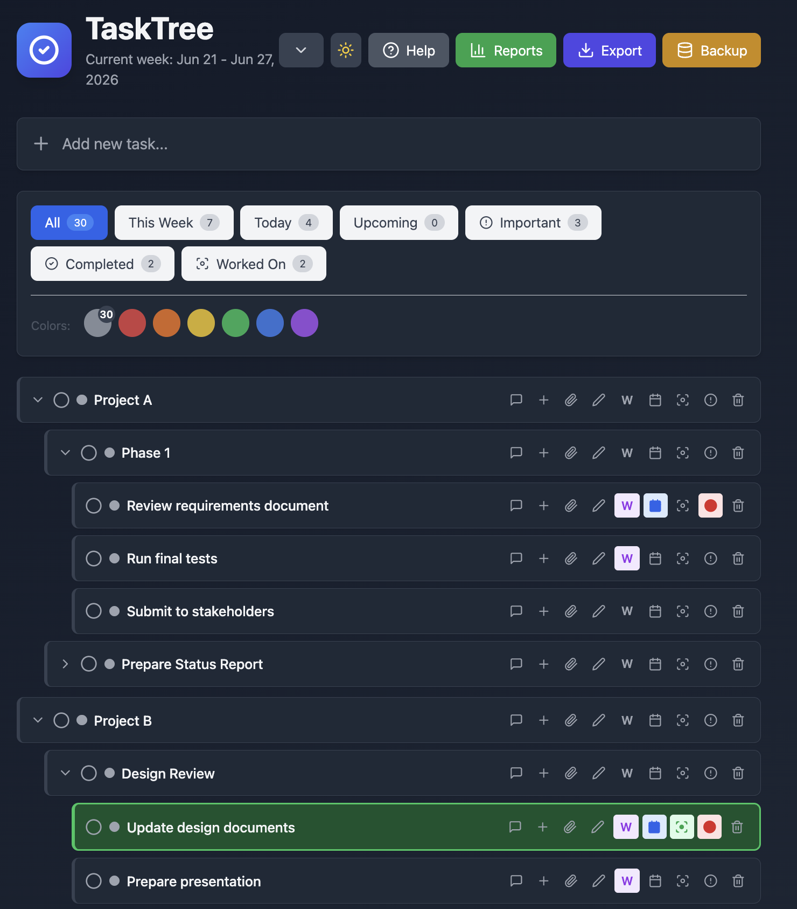

# TaskTree

This todo list application offers two features together that I was not able to find in other todo list applications:

1. **Hierarchical Tasks** - Unlimited nesting with parent-child relationships
2. **Smart Filtering** - Ability to mark tasks for today, this week, important, and more, and filter them, allowing to update the filtered tasks, causing the origin tasks to be updated.



**Key Elements:**
- **Add Task** - Click the "+" button at the top to create new tasks
- **Filter Buttons** - All, This Week, Today, Upcoming, Important, Completed, Worked On (each shows task count)
- **Color Filters** - Seven color circles to filter tasks by category
- **Task Actions** - Each task has buttons for: comments, add subtask, attachments, edit, This Week flag, due date, focus tracking, important flag, and delete
- **Hierarchical Structure** - Tasks can have unlimited subtasks (expand/collapse with arrow)
- **Quick Color Change** - Click the colored dot next to any task title to change its color

## Features

### 📋 Core Task Management
- **Hierarchical Tasks** - Unlimited nesting with parent-child relationships
- **Drag & Drop** - Reorder tasks and move between parents
- **Quick Actions** - Complete, edit, delete, and add subtasks
- **Auto-Hide Completed** - Keep your lists clean and focused

### 🏷️ Task Organization
- **Today Flag** (📅) - Mark tasks for immediate focus
- **This Week Flag** (W) - Weekly planning and organization
- **Important Flag** (🔴) - Highlight critical tasks
- **Focus Tracking** (🎯) - Track which tasks you're actively working on
- **7 Color System** (🎨) - Categorize tasks with Gray, Red, Orange, Yellow, Green, Blue, Purple
- **Quick Color Change** - Click the colored dot next to any task title to instantly change its color
- **Due Dates** - Set deadlines and track overdue tasks

### 🔍 Smart Filtering
- **All** - View complete hierarchy
- **This Week** - Tasks marked for the week
- **Today** - Tasks marked for today OR due today/overdue
- **Upcoming** - All tasks with deadlines (overdue, today, and next 7 days)
- **Important** - Critical tasks only
- **Color Filters** - Filter by any of 7 colors
- **Task Count Badges** - Each filter button shows the number of matching tasks at a glance
- **Completed Period** - View tasks completed in date range
- **Parent Breadcrumbs** - See task location in filtered views (📁 Parent › Grandparent)
- **Expandable in Filters** - View subtasks even in filtered views

### 💬 Collaboration & Notes
- **Comments** - Add unlimited notes to any task
- **Edit Comments** - Update notes as tasks progress
- **Attachments** - Upload files to tasks

### 📊 Reports & Export
- **Markdown Export** - Export all active tasks
- **Completed Report** - Generate reports for completed tasks in date range
- **Worked On Report** - Track focus time across tasks

### 🌙 User Experience
- **Dark Mode** - Easy on the eyes
- **Responsive Design** - Works on all screen sizes
- **Keyboard Friendly** - Efficient workflows
- **Tooltips** - Helpful hints on every button

## Quick Start

### Prerequisites
- Python 3.8+
- Node.js 16+
- npm or yarn

### Installation

1. **Clone the repository:**
```bash
git clone https://github.jpl.nasa.gov/khavelun/tasktree.git
```

2. **Navigate to the project directory:**
```bash
cd tasktree
```

3. **Install dependencies (only once):**
```bash
pip install -r requirements.txt
npm install
```

### Running the Application

```bash
./start.sh
```

The application will be available at: http://localhost:5173

### Stopping the Application

```bash
./stop.sh
```

## Database Management

### Backup Database
Create a timestamped backup:
```bash
./backup_db.sh
```
Backups are saved to `backups/todos_backup_YYYYMMDD_HHMMSS.db`

### Reset Database
Reset to empty database (automatically creates backup first):
```bash
./reset_db.sh
```

## Project Structure

```
todo/
├── app.py                 # Flask backend API
├── todos.db              # SQLite database
├── requirements.txt      # Python dependencies
├── package.json          # Node.js dependencies
├── start.sh             # Start both servers
├── stop.sh              # Stop both servers
├── backup_db.sh         # Backup database
├── reset_db.sh          # Reset database
├── backups/             # Database backups
├── uploads/             # File attachments
└── src/
    ├── App.jsx          # Main React application
    └── main.jsx         # React entry point
```

## Technology Stack

### Backend
- **Flask** - Python web framework
- **SQLAlchemy** - ORM for database management
- **SQLite** - Lightweight database
- **Flask-CORS** - Cross-origin resource sharing

### Frontend
- **React** - UI framework
- **Vite** - Build tool and dev server
- **TailwindCSS** - Utility-first CSS
- **Lucide React** - Icon library
- **date-fns** - Date manipulation

## API Endpoints

- `GET /api/todos` - Get all todos with hierarchy
- `POST /api/todos` - Create new todo
- `PATCH /api/todos/:id` - Update todo
- `DELETE /api/todos/:id` - Delete todo (cascading)
- `POST /api/todos/:id/upload` - Upload attachment
- `POST /api/todos/:id/comments` - Add comment
- `PATCH /api/comments/:id` - Update comment
- `DELETE /api/comments/:id` - Delete comment

## Tips & Best Practices

1. **Use Today for immediate focus** - Mark 3-5 tasks you'll work on today
2. **Use This Week for planning** - Mark tasks for the week ahead
3. **Color code consistently** - Define your own system (e.g., Red = urgent, Blue = work)
4. **Break down complex tasks** - Use subtasks for step-by-step progress
5. **Use Focus tracking** - Click 🎯 when you start working on a task
6. **Regular backups** - Run `./backup_db.sh` before major changes
7. **Use filters effectively** - Switch between views to stay focused

## Keyboard Shortcuts

- Click task title to expand/collapse
- Drag tasks to reorder
- Click icons for quick actions

## Author

**Klaus Havelund** (klaus.havelund@jpl.nasa.gov)

This is a personal project.

## License

MIT License - Feel free to use and modify for your own needs.

